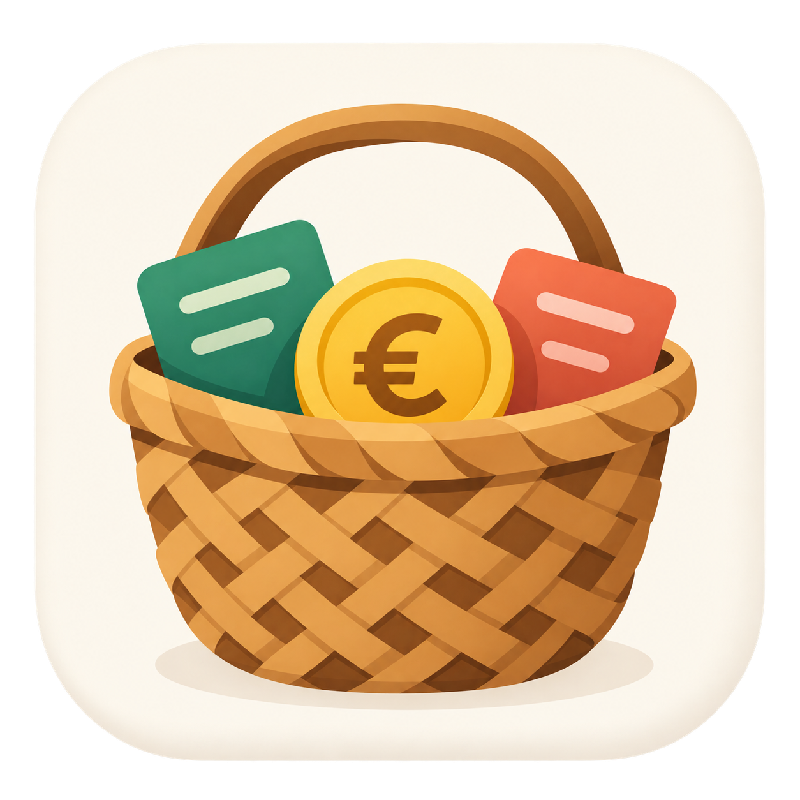

<p align="center"></p>

# Cabàs

**Els teus diners, sota control.**

Cabàs és un projecte d’app Android lliure i gratuïta de finances personals, inspirada en Kakebo, amb el valencià com a llengua principal.

## Estat

En preparació. Este repositori conté la documentació inicial i el logo. Encara no hi ha codi Android, APK ni una aplicació compilable. Les funcions següents són objectius pendents.

## Principis

- Funcionament offline i dades al dispositiu.
- Sense publicitat, telemetria, rastreig ni comptes d’usuari.
- Sense connexió bancària: registre manual i conscient dels moviments.
- Programari lliure i gratuït amb llicència AGPL-3.0-or-later.
- Interfície senzilla, accessible i en valencià.

## Funcions previstes

- Registre d’ingressos i despeses per data i categoria.
- Pressupost mensual i objectiu d’estalvi.
- Categories inspirades en Kakebo: necessitats, desitjos, cultura i imprevistos.
- Resum i reflexió de final de mes.
- Exportació, importació i còpies de seguretat locals controlades per l’usuari.

## Tecnologia prevista

Kotlin, Jetpack Compose i Room. Les versions i l’Android mínim es decidiran quan s’inicialitze el projecte.

## Com començar

```sh
git clone https://github.com/jossanmar9/cabas.git
cd cabas
```

Encara no hi ha ordres de compilació ni proves; s’afegiran amb el projecte Android.

- [Guia de contribució](CONTRIBUTING.md)
- [Roadmap](docs/ROADMAP.md)
- [Decisions de disseny](docs/DESIGN.md)
- [Historial de canvis](CHANGELOG.md)
- [Identitat visual](assets/branding/README.md)

## Llicència

Copyright (C) 2026 Cabàs contributors.

GNU Affero General Public License, versió 3 o qualsevol versió posterior (`AGPL-3.0-or-later`). Consulta [LICENSE](LICENSE).
